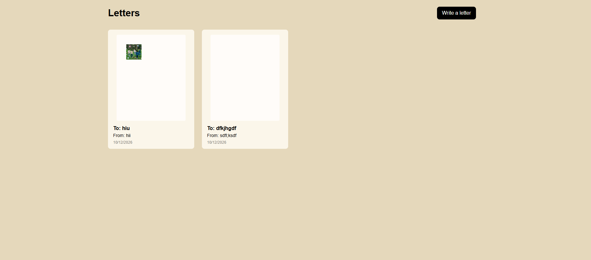

# What is this?
Return to sender is a website I made to make very late birthday cards for my friends. If you've been in hack club for like any amount 
of time you would know that birthday cards are a long standing tradition in the community where its one biiig figma file and everyone signs it with a cute little message. However I
keep forgetting to sign them (yeah....). SO I made this app to try to make up for all the missed birthday cards

**This app is not fully developed yet, only the birthday card maker part is developed**

# How does it work?

When you first click on the return to sender app, it directs you to page with one button haha its the start button

After you click the start button you will go to another page, this time without the same background but a grid layout with a few pre-written cards (yay!). Everytime you save a card, it will show up here!!

and then the final page and where most of my progress fully is is the last page where you can upload your own images, add text and resize the text to your liking for your birthday card. 

When you want to save the birthday card, you just need to press the save button, a pop up will appear asking you for a from and a to sender and bam you have your birthday card!

# tech stack!
For this project I mostly worked with react with the help of supabase for all the sql and back end stuff :) 

